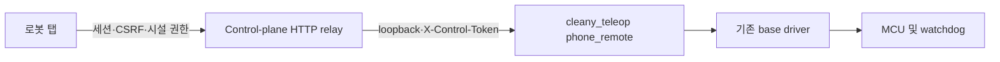

# 로봇 탭 수동 조종

로봇 상세 화면은 기존 phone controller처럼 원형 이동 스틱과 반시계·시계 회전
슬라이더를 사용합니다. 스틱 거리로 속도를 조절하며 두 입력을 동시에 사용할 수 있습니다.
이동은 방향키, 회전은 A/D로도 조작합니다. Space 또는 Esc는 입력을 해제합니다.
속도 상한은 바퀴 회전 속도(rad/s)이며 초기값은 0.5, 최솟값은 0.1입니다.
입력을 모두 놓거나 포커스, 화면, 시설이 바뀌면 정지를 요청합니다. 연결 오류 후에는
자동 재개하지 않으며 새 입력이 필요합니다. 화면의 정지는 물리 비상정지와 다릅니다.

이동 스틱에는 8% 원형 dead zone과 단위원 제한을 적용합니다. Backend는
`vector: [forward, left, ccw]`의 각 축을 -1~1 범위로 검증한 뒤 원래 값으로 전달합니다.
바퀴별 속도 혼합과 제한은 기존 phone controller가 수행합니다.

## 연결과 권한

Backend는 ROS 명령을 직접 발행하지 않습니다. `cleany/phone-nav2-demo` checkout의
`cleany_teleop` HTTP 계약을 사용하며, 기존 controller가 단일 입력 소유자, 증가하는
요청 번호, 250 ms 입력 만료, ENABLE/STOP 확인과 driver 제한을 유지합니다.
Dashboard는 70 ms 주기로 갱신하며 지연된 응답이 새 입력을 만들지 않습니다.

| Endpoint | 계약 |
|---|---|
| `GET /api/robots/{robot_id}/manual/status?site_id=...` | 인증된 시설의 조종 가능 여부와 MCU 응답 상태 |
| `POST /api/robots/{robot_id}/manual/control?site_id=...` | `press`, `update`, `stop`, client ID와 증가 sequence |

조종 키는 서버 파일에서 읽으며 브라우저에 전달하지 않습니다. 브라우저 client ID는
로그인 세션별로 분리하여 기존 controller에 전달합니다. 대기·진행 중인 미션이 있으면
이동 입력을 거부하지만 STOP은 허용합니다. 새 미션과 수동 입력의 진입은 직렬화하며,
설정된 조종 서버의 정지 확인이 없으면 새 미션을 거부합니다. 같은 idempotency key의
기존 미션 조회는 이 검사를 반복하지 않습니다. 로봇 내부 자동·수동 전환과 안전 허가는
기존 Robot runtime의 책임입니다. Backend는 단일 worker로 실행합니다.

Demo·녹화 UI는 조종 API를 호출하지 않습니다. Backend의 mock mode도 relay를 열지
않습니다. 실제 phone server의 `--mock`을 검증에 쓰는 경우에는 화면에 모의 조종으로
표시하며, 이를 실제 MCU 또는 주행 검증으로 해석하지 않습니다.

## Jetson 설정

| 환경 변수 | 값 / 의미 |
|---|---|
| `CLEANY_TELEOP_URL` | `http://127.0.0.1:8766`; loopback HTTP origin만 허용 |
| `CLEANY_TELEOP_TOKEN_FILE` | 기존 phone_remote의 `--token-file`과 같은 절대 경로 |
| `CLEANY_TELEOP_TIMEOUT_SECONDS` | 기본 0.18초; upstream 응답 제한 |

Jetson 기본 연결 키 위치는 `/home/cleany/.local/state/cleany/teleop/web-token`입니다.
`~/.config/cleany-control-plane/backend.env`에 위 두 연결 설정을 넣고 Backend를
재시작합니다. 이 설정은 phone_remote, base driver 또는 MCU를 시작하지 않습니다.
조종 서버가 꺼져 있으면 화면은 연결 안 됨으로 표시하고 조종 입력을 비활성화합니다.
기존 주행 서버를 다른 token 경로로 실행한다면 같은 경로로 설정을 맞춥니다.

phone_remote 실행과 하드웨어 준비는 Cleany의
`docs/implementation/how-to/phone-navigation.md`와
`ros2_ws/src/cleany_teleop/docs/interfaces.md`를 따릅니다. 자동 주행 서버와 별도의
수동 서버를 동시에 띄우지 않습니다.

## 헤드캠

조종 패널 위에 최신 헤드캠 프레임을 표시합니다. 독립 `cleany_telemetry camera_preview`의
`/api/camera?topic=...`를 읽기 전용으로 중계하며 카메라 장치를 다시 열지 않습니다.
`GET /api/robots/{robot_id}/camera/head?site_id=...`는 로그인과 시설 권한을 검사하고
JPEG만 반환합니다. 2초 넘게 오래된 프레임, 연결 오류와 비정상 응답은 503으로 처리합니다.
브라우저는 요청 완료 후 200 ms 간격으로 갱신하며, 영상 유실 시 마지막 화면을 지웁니다.
숨긴 탭, Demo와 녹화 UI에서는 실시간 영상을 요청하지 않습니다.

- `CLEANY_CAMERA_PREVIEW_URL`: loopback HTTP origin, 예: `http://127.0.0.1:8769`
- `CLEANY_HEAD_CAMERA_TOPIC`: `/camera/head/color/image_redacted`. 운영 프리뷰는 이 토픽의 응답만 전달합니다.
- `CLEANY_CAMERA_TIMEOUT_SECONDS`: Backend 요청 제한, 기본 1초

Jetson의 `cleany-dashboard-camera.service`는 `CLEANY_TELEMETRY_INSTALL` overlay의 `cleany_telemetry camera_preview`를
loopback으로 실행합니다. `~/.config/cleany-control-plane/camera.env`에서 해당 영상
발행자와 같은 `ROS_DOMAIN_ID`, `RMW_IMPLEMENTATION`을 지정합니다. 카메라 드라이버,
모터, Logger 녹화를 시작하지 않습니다. 현재 현장 연결은 실행 중인 RealSense의 `/camera/color/image_raw/compressed`이며
`ROS_DOMAIN_ID=0`, `RMW_IMPLEMENTATION=rmw_cyclonedds_cpp`와 카메라 프로세스의
`CYCLONEDDS_URI=file:///home/cleany/cleany/containers/vision/cyclonedds/host.xml`을
공유합니다. 영상 토픽 또는 DDS 설정을 변경할 때 환경 설정도 함께 변경합니다.

기존 배포의 `CLEANY_CAMERA_MONITOR_URL`은 `CLEANY_CAMERA_PREVIEW_URL`로 변경합니다.
카메라 서비스만 사용하는 경우 Backend, pose relay와 dev_monitor는 실행할 필요가 없습니다.
미리보기 HTTP는 loopback에만 열고 외부 접근은 Backend의 인증 경로를 사용합니다.

## Jetson 로컬 게임패드

`CLEANY_GAMEPAD_SOCKET`에 같은 사용자 전용 디렉터리 안의 절대 경로를 지정하면 Backend가 모드 0600의 Unix 소켓을 엽니다. 예를 들어 Jetson UID가 1000이면 `/run/user/1000/cleany-gamepad.sock`을 사용합니다. 기본값은 빈 문자열이며 입력 서비스를 비활성화합니다. 기존 loopback teleop URL과 토큰 설정, 등록된 로봇과 시설이 필요합니다.

로컬 ROS 어댑터는 연결마다 개행으로 끝나는 JSON 객체 하나를 보냅니다. `command`는 기존 ManualCommand 형식입니다. `expires_at`은 같은 호스트의 단조 시각(초)입니다. Backend는 등록된 로봇의 시설을 조회하고 대시보드와 동일한 잠금, 미션 대기열과 안전 상태 검사를 거칩니다. 조종기별 ID와 증가 순번은 기존 서버까지 전달합니다. 임박한 입력만 승인하고 패드의 정지는 해당 소유자만 해제합니다. 최초 허가 응답의 `ok`와 `forward_only`를 확인한 뒤 주행을 갱신합니다. 만료되거나 더 최신 순번으로 대체된 갱신은 `discarded: true`로 응답합니다. 미션, 안전 또는 소유권 거부는 주행 중지를 요구합니다. Backend는 loopback HTTP 클라이언트를 재사용하고 요청마다 현재 토큰을 읽습니다. 이 기능은 게임패드 명령을 지원하는 버전의 `cleany_teleop`와 함께 배포합니다.
